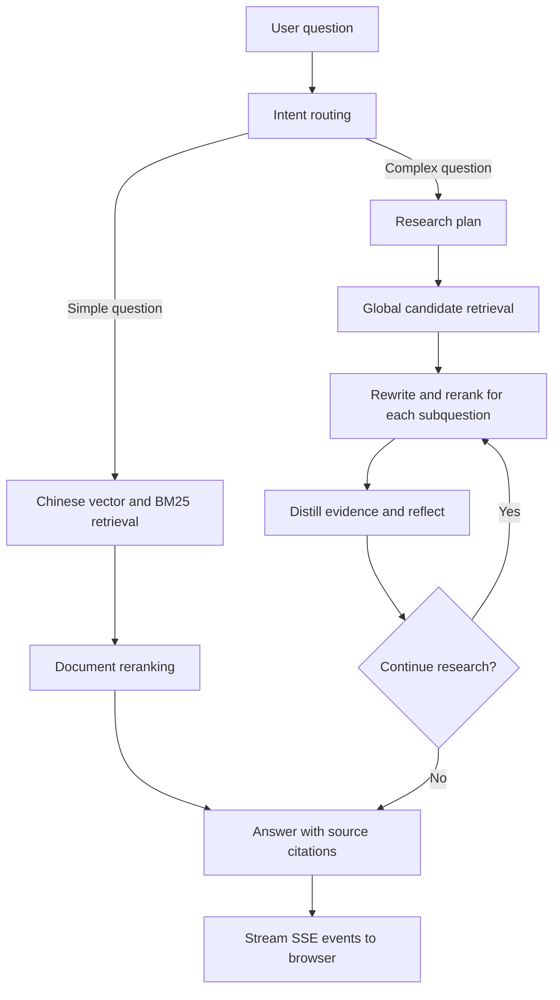

# 🚀 TechPulse-RAG: A RAG-Powered Intelligent Q&A System for Tech Trends

**A LangGraph-based multi-agent RAG research prototype with question routing, step-by-step research, and streamed answers with source citations.**

[中文文档](README.md) · [Quick start](#quick-start) · [Verification and experiments](#verification-and-experiments)

TechPulse-RAG combines FastAPI, LangGraph, Ollama embeddings, Chroma vector search, BM25, and a cross-encoder reranker in a local question-answering demo. Simple questions use one retrieval pass. Complex questions go through planning, candidate retrieval, reranking, evidence distillation, and reflection before the system produces an answer with numbered sources.

This project is not affiliated with the official LangChain project. It remains a research prototype: live-model end-to-end behavior and reproducible benchmark results have not been fully verified.

## Features and implementation status

| Feature | Current implementation |
| --- | --- |
| Question routing | Selects a fast path or a deeper research path based on the question |
| Hybrid retrieval | Combines Chinese Chroma vector retrieval and Chinese BM25 ranking by default |
| Bilingual indexes | Initializes Chinese and English indexes; the default answer graph does not yet fuse English results |
| Query rewriting | Extracts Chinese and English queries, entities, and time descriptions; the main retrieval path currently uses the Chinese query |
| Cross-encoder reranking | Reranks candidate documents with a BGE reranker |
| Step-by-step research | Plans subquestions, distills evidence at each step, and decides whether to continue |
| Streaming answers | FastAPI sends progress events, text chunks, and source metadata over SSE |
| Browser demo | A Vue page displays conversations, research progress, and sources; sessions are stored in the browser |

The default answer workflow searches local documents and does not search the live web. Retrieval-weight, entity, or time-display fields do not mean that a corresponding dynamic retrieval strategy is implemented.

## Workflow



## Repository layout

```text
TechPulse-RAG/
├── backend/
│   ├── server.py                 # FastAPI, web entry point, and SSE endpoint
│   ├── index.html                # Browser demo
│   ├── rag_core/
│   │   ├── config.py             # Environment variables and project-relative paths
│   │   ├── graph.py              # LangGraph workflow
│   │   ├── models.py             # State and structured-output models
│   │   ├── utils.py              # Document preparation, deduplication, and source numbering
│   │   └── components/           # agents, nodes, and retrievers
├── experiments/                  # Experiment commands runnable from the repository root
│   ├── agent_experiment.py       # Generate CoT, Naive RAG, and Agentic RAG answers
│   ├── agent_results.py          # Evidence-based model-judge comparison
│   ├── evaluate_retrieval.py     # Retrieval evaluation
│   ├── rrf_ablation.py           # Fusion-weight ablation
│   ├── generate_qa_dataset.py    # Single-document retrieval evaluation data
│   ├── generate_multihop_dataset.py # Multihop question generation
│   └── measure_performance.py    # Manual SSE performance measurement
├── examples/data/                # Public synthetic demo corpus
├── tests/                        # Regression tests without live models
├── .github/                      # CI, issue templates, and PR template
├── .env.example                  # Configuration template with placeholders only
├── requirements.txt              # Service runtime dependencies
├── requirements-dev.txt          # Lightweight offline test dependencies
└── LICENSE                       # MIT
```

The repository excludes the original news CSV files, experiment JSON and figures, local models, Chroma databases, BM25 caches, and the real `.env`. The included examples are synthetic. Third-party models, software, and original corpora retain their own licenses.

## Quick start

### 1. Prepare the environment

Python **3.11**, Git, a running [Ollama](https://ollama.com/) service, and a DashScope account authorized to use the selected Tongyi models are recommended. The reranker can run on a CPU; actual speed and memory use depend on your model, device, and corpus.

Clone the repository and enter the directory containing this README. On Windows PowerShell:

```powershell
python -m venv .venv
.\.venv\Scripts\Activate.ps1
python -m pip install --upgrade pip
python -m pip install -r requirements.txt
Copy-Item .env.example .env
```

On macOS or Linux:

```bash
python3 -m venv .venv
source .venv/bin/activate
python -m pip install --upgrade pip
python -m pip install -r requirements.txt
cp .env.example .env
```

If you already have a `.env`, merge the template settings into it manually and preserve your own configuration. Dependency ranges are specified, but the full inference environment is not locked. Install a GPU build of PyTorch appropriate for your device if needed.

### 2. Configure models and demo data

Edit the root `.env`, replace `DASHSCOPE_API_KEY` with your own key, and confirm that your account can call `LLM_MODEL` and `FAST_LLM_MODEL`. The template retains model names from the original project; availability depends on your provider account.

Start Ollama and pull the embedding model:

```bash
ollama pull qwen3-embedding:4b
```

The Ollama desktop app normally runs a background service. Other installations may require `ollama serve`. The template uses `http://127.0.0.1:11434`.

`.env.example` points to synthetic Chinese and English CSV files under `examples/data/` and keeps demo indexes separate under `data/demo/`. The reranker defaults to `BAAI/bge-reranker-large`, which must be downloaded on first use. If you already have the model, set `RERANKER_MODEL_PATH=./backend/models/bge-reranker-large`. The third-party model retains its own license.

### 3. Start the service

Run this from the repository root:

```bash
python -m uvicorn backend.server:app --host 127.0.0.1 --port 8000
```

Open [http://127.0.0.1:8000](http://127.0.0.1:8000). The API reference is at [http://127.0.0.1:8000/docs](http://127.0.0.1:8000/docs), and the health endpoint is `/health`. The first startup creates indexes and loads the reranker, so it may take time depending on downloads, hardware, and corpus size. The server accepts requests after initialization succeeds.

Example question: **How does the demo combine keyword and vector retrieval?** The synthetic data is for checking the workflow, not benchmarking retrieval quality. The browser page loads frontend libraries from a CDN and needs network access to that CDN.

### 4. Use your own corpus

Prepare a UTF-8, headerless, five-column CSV in the order `id,title,content,date,URL`; see the [data format](examples/data/README.md). Configure the paths for both languages. Initialization currently requires data or valid indexes for both languages.

**Use new Chroma and BM25 paths when changing the corpus, chunking settings, or embedding model.** Existing nonempty indexes are reused without detecting corpus changes. Load pickle caches only when they were generated in an environment you trust.

## Main configuration

Configuration is loaded from the root `.env`; process environment variables take precedence. Relative data and index paths resolve from the repository root, independent of the shell's current directory.

| Variable | Purpose |
| --- | --- |
| `DASHSCOPE_API_KEY` | Required credential for the answer model |
| `LLM_MODEL` / `FAST_LLM_MODEL` | Research and generation model; routing and policy model |
| `MAX_RESEARCH_ITERATIONS` | Positive integer, default 5; the graph execution budget follows this value |
| `OLLAMA_BASE_URL` / `EMBEDDING_MODEL` | Local embedding service and model |
| `CSV_FILE_PATH_ZH` / `CSV_FILE_PATH_EN` | Chinese and English CSV files |
| `CHROMA_DB_DIR_ZH` / `CHROMA_DB_DIR_EN` | Chinese and English vector-index directories |
| `BM25_INDEX_PATH_ZH` / `BM25_INDEX_PATH_EN` | Chinese and English BM25 caches |
| `RERANKER_MODEL_PATH` | Hugging Face model ID or explicit local path |
| `CORS_ORIGINS` | Comma-separated browser origins; the same-origin demo needs no extra setting |
| `EVAL_API_KEY` / `EVAL_BASE_URL` / `EVAL_MODEL` | Experiment-only settings, separate from the answer service |
| `EVAL_PROXY_URL` | Optional explicit proxy for experiment scripts |

For local model paths, use `./`, `../`, `~`, or an absolute path. Other path-like strings that do not exist are treated as model IDs. Without CSV or index settings, the program retains compatibility defaults for original local research data under `backend/`; new users should use the full example configuration. The answer service calls models through the DashScope SDK and does not read `OPENAI_BASE_URL` or `EVAL_BASE_URL`.

## Verification and experiments

Lightweight offline checks need no Ollama service, model weights, or real API key:

```bash
python -m pip install -r requirements-dev.txt
python -m unittest discover -s tests -v
python -m pyflakes backend experiments tests
```

Tests cover path configuration, experiment input and output, frontend SSE decoding, and HTTP/SSE behavior with a fake backend. CI runs the same offline checks. **These checks do not validate live model calls, retrieval quality, or experiment metrics.**

After installing `requirements.txt`, experiment tools additionally need `openai>=1.50,<3`, `requests>=2.32,<3`, `tqdm>=4.66,<5`, `tabulate>=0.9,<1`, and `httpx>=0.27,<1`. Run `python -m experiments.<module> --help` from the repository root to see each command's options. `agent_experiment` generates answers, and `agent_results` judges them. You must provide the experiment data and results yourself; the synthetic examples cannot reproduce the original experiment numbers.

## Current limitations

- The main graph does not yet fuse English retriever results into default retrieval, and it does not search the web.
- Experiment scripts require additional dependencies, data, and model services; the service entry point is `backend.server:app`.
- Structured model output may fail validation. Empty research plans are rejected, but comprehensive retry and recovery are not implemented.
- The service has no user authentication, rate limiting, or per-session quotas. Use it as a local demo.
- Source markers do not guarantee that an answer is accurate; check the retrieved documents.

## Contributing and license

Contributions through issues and pull requests are welcome. Do not post credentials, private corpora, or other sensitive information in public issues.

Original project code and synthetic examples are available under the [MIT License](LICENSE). That license does not change the terms of third-party models, software, or original news corpora.
