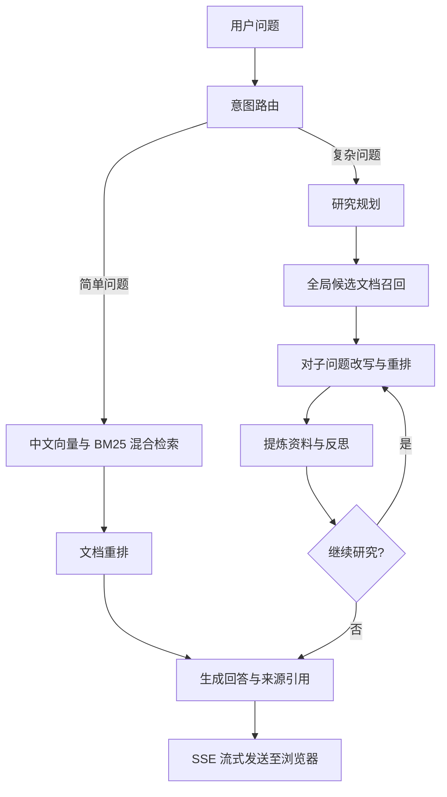

# 🚀 TechPulse-RAG: 基于 RAG 的科技动向信息智能问答系统

**基于 LangGraph 的多智能体 RAG 研究原型，支持问题路由、分步研究和带来源引用的流式回答。**

[English](README.en.md) · [安装与使用](#快速开始) · [验证与实验](#验证与实验)

TechPulse-RAG 将 FastAPI、LangGraph、Ollama 嵌入、Chroma 向量检索、BM25 和交叉编码器重排组合成一个本地问答演示。简单问题走单次检索，复杂问题经过规划、候选资料召回、逐步重排、信息提炼与反思，最后输出带来源编号的回答。

本项目与 LangChain 官方项目无隶属关系。目前是研究原型，尚未提供完整的真实模型端到端验证和可复现实验基准。

## 功能与实现范围

| 功能 | 当前实现 |
| --- | --- |
| 问题路由 | 根据问题选择快速路径或深度研究路径 |
| 混合检索 | 默认融合中文 Chroma 向量检索与中文 BM25 排名 |
| 双语索引 | 初始化中英文索引；默认问答图尚未融合英文检索结果 |
| 查询改写 | 提取中英文查询、实体与时间描述；当前主检索使用中文查询 |
| 交叉编码器重排 | 使用 BGE reranker 对候选文档重排 |
| 分步研究 | 规划子问题，逐步提炼资料，检查是否继续 |
| 流式回答 | FastAPI 通过 SSE 返回过程事件、文本片段和来源元数据 |
| 浏览器演示 | Vue 页面展示对话、研究过程和来源；会话存储于浏览器本地 |

默认问答流程使用本地语料，不执行实时网页搜索。检索权重、实体或时间展示字段不代表当前已实现相应动态检索策略。

## 工作流程



## 项目结构

```text
TechPulse-RAG/
├── backend/
│   ├── server.py                 # FastAPI、网页入口和 SSE 接口
│   ├── index.html                # 浏览器演示
│   ├── rag_core/
│   │   ├── config.py             # 环境变量和项目相对路径
│   │   ├── graph.py              # LangGraph 工作流
│   │   ├── models.py             # 状态与结构化输出模型
│   │   ├── utils.py              # 文档整理、去重和引用编号
│   │   └── components/           # agents、nodes、retrievers
├── experiments/                  # 可从根目录运行的实验命令
│   ├── agent_experiment.py       # 生成 CoT / Naive / Agentic 三组答案
│   ├── agent_results.py          # 基于证据的模型裁判比较
│   ├── evaluate_retrieval.py     # 检索质量评测
│   ├── rrf_ablation.py           # 融合权重消融
│   ├── generate_qa_dataset.py    # 单文档检索评测集生成
│   ├── generate_multihop_dataset.py # 多跳问答生成
│   └── measure_performance.py    # SSE 性能手动测量
├── examples/data/                # 可公开的合成演示语料
├── tests/                        # 无需真实模型的回归测试
├── .env.example                  # 仅含占位符的配置模板
├── requirements.txt              # 服务运行依赖
├── requirements-dev.txt          # 轻量离线测试依赖
└── LICENSE                       # MIT
```

原始新闻 CSV、实验 JSON/图表、本地模型、Chroma 数据库、BM25 缓存和真实 `.env` 不随源码分发。示例数据为合成内容；第三方模型、软件和原始语料遵循各自许可。

## 快速开始

### 1. 准备环境

推荐 Python **3.11**，以及 Git、可运行的 [Ollama](https://ollama.com/) 服务和一个可调用所选通义模型的 DashScope 账户。CPU 可运行重排器；实际速度和内存需求取决于模型、设备与语料规模。

将仓库克隆后，进入包含本 README 的目录。Windows PowerShell：

```powershell
python -m venv .venv
.\.venv\Scripts\Activate.ps1
python -m pip install --upgrade pip
python -m pip install -r requirements.txt
Copy-Item .env.example .env
```

macOS / Linux：

```bash
python3 -m venv .venv
source .venv/bin/activate
python -m pip install --upgrade pip
python -m pip install -r requirements.txt
cp .env.example .env
```

若本地已经有 `.env`，请手动合并模板中的设置，保留自己的配置。依赖清单给出了兼容的大版本范围，尚未锁定完整推理环境；GPU 版 PyTorch 的安装方式请按设备选择。

### 2. 配置模型与演示数据

编辑根目录 `.env`，将 `DASHSCOPE_API_KEY` 替换为自己的密钥，并确认 `LLM_MODEL` 和 `FAST_LLM_MODEL` 是账户已开通的模型。模板保留原工程的默认模型名称，模型可用性以服务端账户为准。

启动 Ollama 服务，并拉取嵌入模型：

```bash
ollama pull qwen3-embedding:4b
```

桌面版 Ollama 通常会在后台提供服务；其他安装方式可按需运行 `ollama serve`。模板使用 `http://127.0.0.1:11434`。

`.env.example` 已指向 `examples/data/` 中的合成中英文 CSV，并把演示索引放入独立的 `data/demo/`。重排模型默认使用 `BAAI/bge-reranker-large`，首次使用需要下载；已有模型时可设置 `RERANKER_MODEL_PATH=./backend/models/bge-reranker-large`。第三方模型遵循其自身许可。

### 3. 启动服务

在项目根目录执行：

```bash
python -m uvicorn backend.server:app --host 127.0.0.1 --port 8000
```

浏览器打开 [http://127.0.0.1:8000](http://127.0.0.1:8000)。接口文档位于 [http://127.0.0.1:8000/docs](http://127.0.0.1:8000/docs)，状态接口为 `/health`。首次启动会创建索引并加载重排模型，耗时取决于模型下载、设备和语料规模。服务在初始化成功后开始接受请求。

示例问题：**演示系统如何结合关键词检索和向量检索？** 合成数据仅用于检查流程，不是检索效果基准。网页通过 CDN 加载前端库，需要相应网络访问。

### 4. 替换自己的语料

准备 UTF-8、无表头的五列 CSV，顺序为 `id,title,content,date,URL`；见 [数据格式](examples/data/README.md)。同时设置两种语言的 CSV 路径。当前初始化仍要求两种语言的数据或有效索引均存在。

**更换语料、分块方式或嵌入模型后，请使用全新的 Chroma 和 BM25 路径。** 已存在的非空索引会直接复用，不会自动检测语料变化。仅加载由自己可信环境生成的 pickle 缓存。

## 主要配置

配置从根目录 `.env` 读取；系统环境变量优先。数据和索引的相对路径均相对于项目根目录，不依赖终端当前目录。

| 变量 | 用途 |
| --- | --- |
| `DASHSCOPE_API_KEY` | 问答模型的必需凭证 |
| `LLM_MODEL` / `FAST_LLM_MODEL` | 研究、生成模型与路由、策略模型 |
| `MAX_RESEARCH_ITERATIONS` | 正整数，默认 5；图执行步数预算随该值配置 |
| `OLLAMA_BASE_URL` / `EMBEDDING_MODEL` | 本地嵌入服务与模型 |
| `CSV_FILE_PATH_ZH` / `CSV_FILE_PATH_EN` | 中英文 CSV |
| `CHROMA_DB_DIR_ZH` / `CHROMA_DB_DIR_EN` | 中英文向量索引目录 |
| `BM25_INDEX_PATH_ZH` / `BM25_INDEX_PATH_EN` | 中英文 BM25 缓存 |
| `RERANKER_MODEL_PATH` | Hugging Face 模型 ID 或显式本地路径 |
| `CORS_ORIGINS` | 逗号分隔的浏览器来源；同源演示无需额外配置 |
| `EVAL_API_KEY` / `EVAL_BASE_URL` / `EVAL_MODEL` | 仅用于研究脚本，独立于问答服务 |
| `EVAL_PROXY_URL` | 研究脚本显式可选代理 |

本地模型路径建议使用 `./`、`../`、`~` 或绝对路径；其他不存在的路径字符串按模型 ID 处理。未配置 CSV/索引变量时，程序保留对 `backend/` 下原有本地研究数据的兼容默认路径。新用户请使用完整的示例配置。问答服务通过 DashScope SDK 调用模型，不读取 `OPENAI_BASE_URL` 或 `EVAL_BASE_URL`。

## 验证与实验

轻量离线检查无需 Ollama、模型权重或真实密钥：

```bash
python -m pip install -r requirements-dev.txt
python -m unittest discover -s tests -v
python -m pyflakes backend experiments tests
```

测试覆盖路径配置、实验输入输出、前端 SSE 解码以及使用替身后端的 HTTP/SSE 行为。这些离线检查**不验证真实模型调用、检索质量或实验指标**。

实验工具在安装 `requirements.txt` 后，还需安装 `openai>=1.50,<3`、`requests>=2.32,<3`、`tqdm>=4.66,<5`、`tabulate>=0.9,<1` 和 `httpx>=0.27,<1`。统一从项目根目录使用 `python -m experiments.<模块名> --help` 查看参数；答案生成见 `agent_experiment`，模型裁判见 `agent_results`。实验数据和结果须自行准备；仓库内的合成示例不能复现原实验数字。

## 当前限制

- 主工作流尚未把英文检索器融合到默认召回中，也没有实现联网搜索。
- 实验脚本需要额外依赖、数据和模型服务；默认服务入口是 `backend.server:app`。
- 模型 JSON 输出可能不符合结构要求；空研究计划会被校验拒绝，尚无全面的重试与恢复机制。
- 当前服务没有用户鉴权、速率限制或会话隔离配额，按本地演示使用。
- 答案带来源标记不保证内容完全准确，应核对检索原文。

## 贡献与许可

欢迎通过 issue 和 pull request 改进项目。请勿在公开 issue 中提交密钥、私有语料或其他敏感信息。

项目原创源码和合成示例采用 [MIT License](LICENSE)。第三方模型、软件和原始新闻语料不因本项目的许可证而变更授权。
